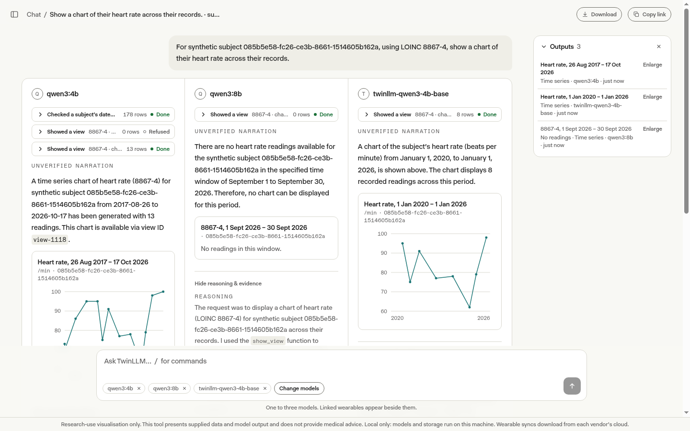
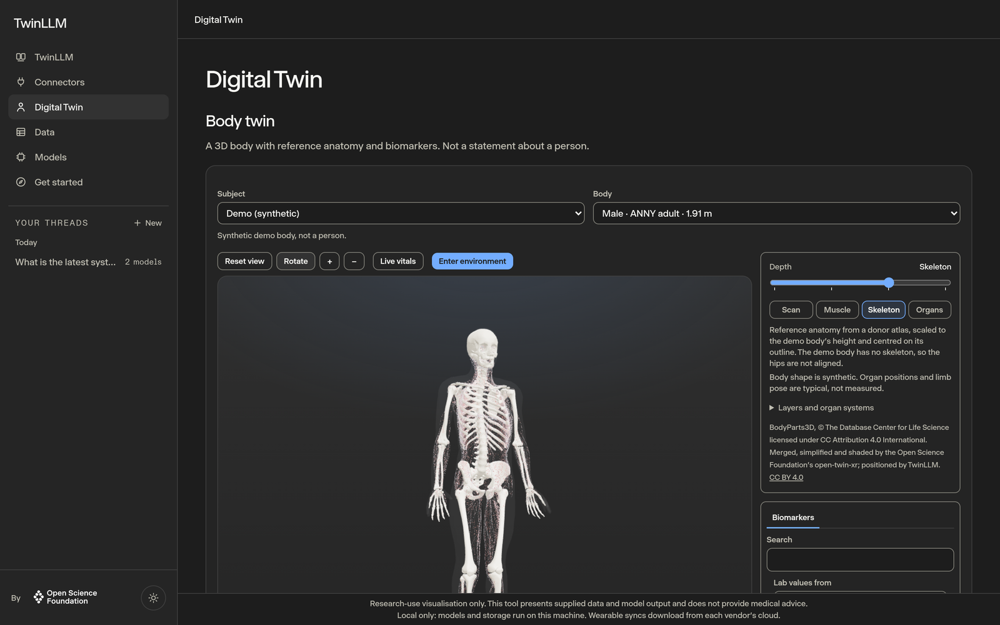
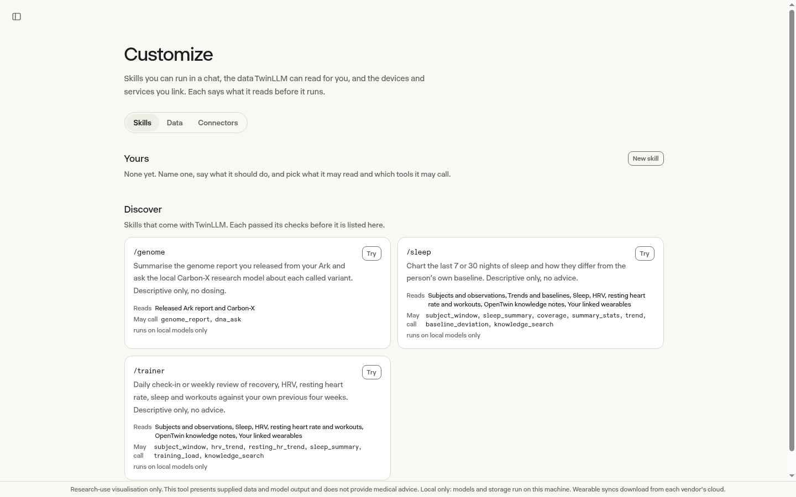
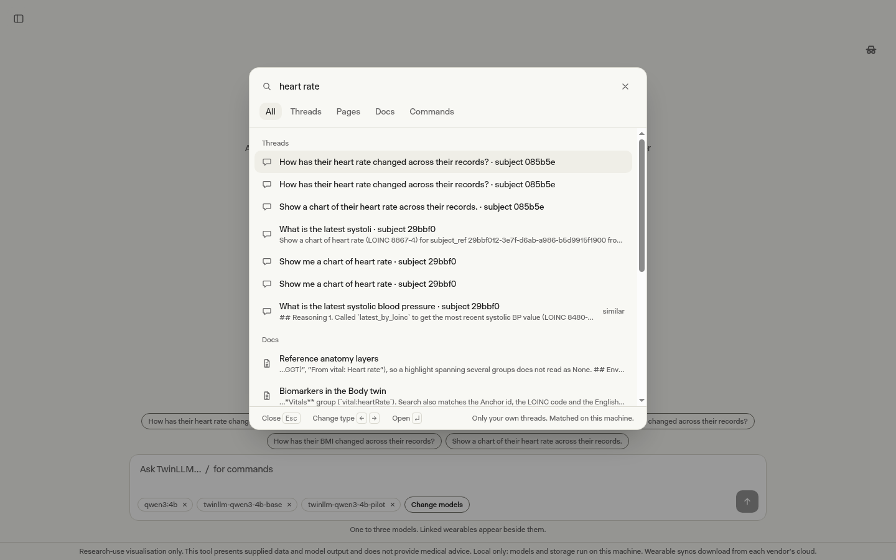
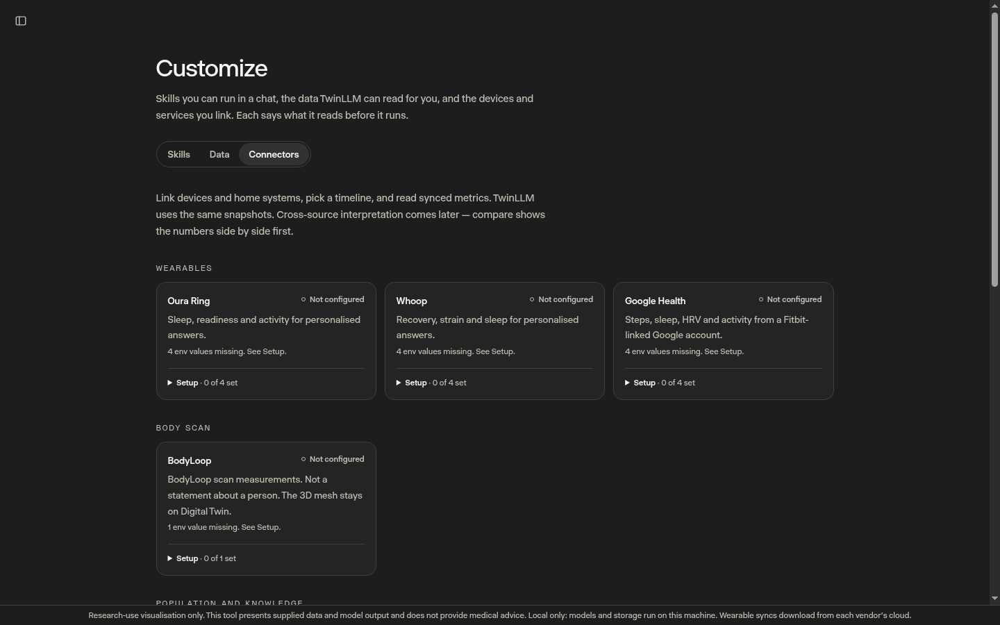

# TwinLLM

Ask questions about health data with open models, side by side, and see which numbers each answer used.

TwinLLM is an open-source research app from the [Open Science Foundation](https://github.com/Opening-Science). It reads wearables, body scans and synthetic patient cohorts through [open-twin](https://github.com/Opening-Science/open-twin), lets up to three open models answer the same question, and shows the tool calls and values behind every answer. It can run entirely on your own machine.

[](https://github.com/Opening-Science/twin-llm/actions/workflows/ci.yml)
[](LICENSE)


<picture>
  <source media="(prefers-color-scheme: dark)" srcset="docs/images/chat-dark.png">
  
</picture>

> **Research use only.** TwinLLM gives no medical advice and is not for diagnostic use. See [Intended use](#intended-use).

## What it does

- **Answers come from tools.** Models never see raw records. They call a small set of closed, capped query tools (latest value, trend, baseline, sleep, HRV, two wearables compared, values around an event), and every call is written to a hash-linked audit log.
- **Several models, one question.** Up to three answer side by side, each with its reasoning, cited values and uncertainty.
- **Local first.** With `LOCAL_ONLY=true` the models, embeddings and database stay on your machine.
- **Synthetic data to start.** A Synthea cohort ships with setup, so you can try everything without a real person's records.

<p>
  
  
</p>
<p>
  
  
</p>

## Run it locally

You need [Bun](https://bun.sh) 1.4, Node.js 26, PostgreSQL 16+ with [pgvector](https://github.com/pgvector/pgvector), Java 21 and [Ollama](https://ollama.com).

```bash
git clone https://github.com/Opening-Science/twin-llm.git
cd twin-llm
bun run setup:local
ollama pull qwen3:4b && ollama pull nomic-embed-text
bun run dev
```

`setup:local` checks what is missing, writes `.env.local`, creates the database, downloads the anatomy and the synthetic evaluation cohort, and ends with a checklist. It is safe to re-run. `bun run doctor` prints the same checks without changing anything. Open <http://localhost:3000>. Wearables, the 10,000-person cohort and everything else: [`docs/runbook.md`](docs/runbook.md).

## Privacy

- With `LOCAL_ONLY=true`, nothing about you needs to leave your machine.
- No outside model service sees personal data; hosted models are for synthetic data only.
- The model gets numbers with units and dates, never records, images or scan meshes.
- Threads open only for their owner, tokens are encrypted, and incognito chats are not stored.

Wearable data still starts in each vendor's cloud. The full table of what goes where is in [`docs/providers.md`](docs/providers.md#what-leaves-the-host).

## How it works



Connectors bring data in as FHIR R4 observations (LOINC codes, UCUM units). A chat turn gives the model a fixed prompt and the query tools; its reply is parsed into a response document with evidence, reasoning, uncertainty and an answer class. More: [models](docs/models.md), [providers](docs/providers.md), [query tools](docs/query-layer.md), [anatomy](docs/anatomy.md), [evaluation](docs/evaluation/harness.md).

## Contributing

Contributions are welcome. Start with [`good first issue`](https://github.com/Opening-Science/twin-llm/labels/good%20first%20issue), read [`CONTRIBUTING.md`](CONTRIBUTING.md) and the [Code of Conduct](CODE_OF_CONDUCT.md), and report security issues privately as in [`SECURITY.md`](SECURITY.md). TwinLLM is maintained by [Peter Dike](https://github.com/CPD9) for the Open Science Foundation; please cite it with [`CITATION.cff`](CITATION.cff).

## Intended use

TwinLLM is experimental software for **research use only**: n-of-1 hypothesis generation and the evaluation of open language models on coded health data. It is not a medical device. Its answers, cited evidence, body-twin views and evaluation results must not be used for medical advice, diagnosis or diagnostic support, disease prediction, monitoring, triage, treatment or any other medical decision. Model output can be wrong even when it cites sources.

Regulatory status depends on actual functions and claims; a research label or the `not_for_diagnostic_use=true` flag does not exempt medical functionality, and `bun run lint:claims` is a floor, not a certificate. A deployment with real wearable, scan or genome data handles health data: operators are responsible for consent, data protection and ethics approval. Read open-twin's [intended use](https://github.com/Opening-Science/open-twin/blob/main/docs/INTENDED-USE.md) first.

## Licence

[Apache-2.0](LICENSE) for TwinLLM's own work. The Open Science Foundation logo, the knowledge notes (CC BY 4.0), open-twin and open-twin-xr (MIT) and the anatomy assets keep their own terms; see [`NOTICE`](NOTICE).
