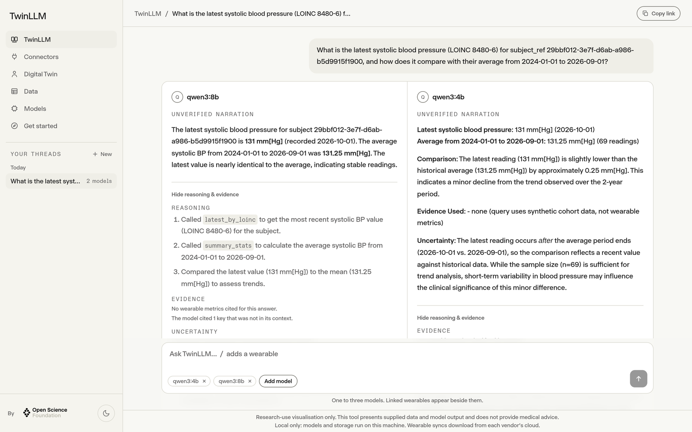
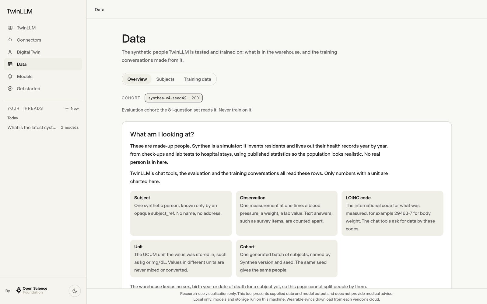
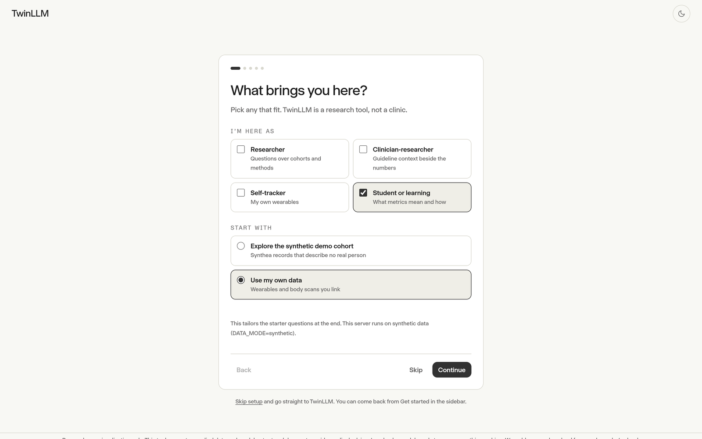
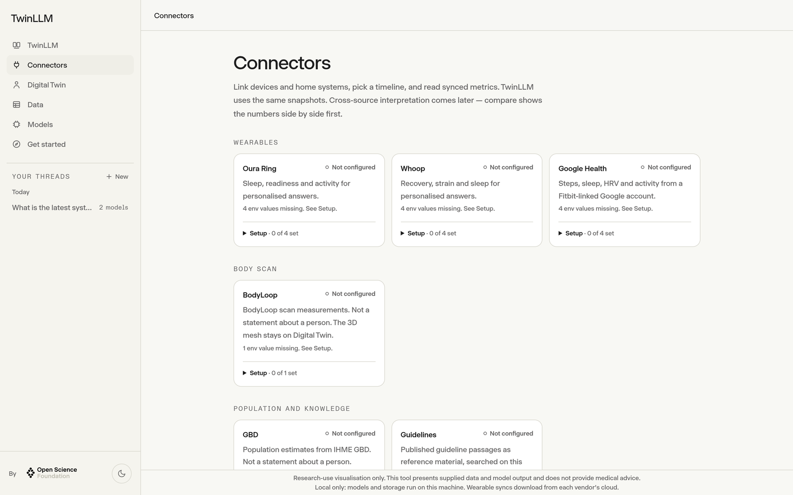

# TwinLLM

**Ask questions about health data with open language models, and see exactly which numbers every answer used.**

TwinLLM is an open-source research application by the [Open Science Foundation](https://github.com/Opening-Science). It connects wearables, body scans and synthetic patient cohorts to open models you can run on your own machine, lets several models answer the same question side by side, and shows the evidence behind every answer. It is built on [open-twin](https://github.com/Opening-Science/open-twin), the foundation's library of health-data connectors to coded FHIR R4.

[](https://github.com/Opening-Science/twin-llm/actions/workflows/ci.yml)
[](LICENSE)




> **Research use only.** TwinLLM gives no medical advice and is not for diagnostic use. See [Intended use](#intended-use).

## Why TwinLLM

Language models are good at sounding sure. Health data needs the opposite: numbers you can trace, units you can trust, and a model that says "not enough data" when that is the honest answer. TwinLLM is a place to work on that in the open:

- **Every number has a source.** Models do not read raw records. They call a small set of closed query tools (latest value, trend, baseline, coverage, comparison) over coded observations, and every call is written to an append-only audit log.
- **Open models, side by side.** Ask one question and get answers from up to three models, each with its reasoning, cited values and uncertainty, so you can compare them on the same footing.
- **Local first.** With `LOCAL_ONLY=true`, models, embeddings and storage all stay on your machine.
- **Honest by design.** Answers that do not rest on enough data are withheld, missing values are never turned into zero, and the interface copy is checked in CI for medical claims.
- **Synthetic data to start with.** A built-in Synthea cohort lets anyone try the full app, run the evaluation or build training data without touching a real person's records.

## What you can do with it

|                   |                                                                                                                              |
| ----------------- | ---------------------------------------------------------------------------------------------------------------------------- |
| **Chat**          | Ask about one subject's measurements with optional wearable context; compare up to three open models.                        |
| **Digital Twin**  | Explore a 3D body with reference anatomy, live vitals and biomarkers lit by organ system.                                    |
| **Data**          | Browse the synthetic cohort: what is measured, how often, for whom, and the training conversations made from it.             |
| **Connectors**    | Link Oura, Whoop and Google Health, a BodyLoop body scanner, and knowledge sources.                                          |
| **Get started**   | A short first-run flow: what you are here for, which data to connect, which sources the model may use, where your data goes. |
| **Evaluation**    | Score models on 81 questions over the synthetic cohort, with every model call cached for replay.                             |
| **Training data** | Turn synthetic cohorts into tool-use conversations for fine-tuning open models.                                              |

<p>
  
  
</p>
<p>
  
  
</p>

## Quick start

You need [Bun](https://bun.sh) 1.4, Node.js 26, PostgreSQL 16 or newer with [pgvector](https://github.com/pgvector/pgvector), and [Ollama](https://ollama.com).

```bash
git clone https://github.com/Opening-Science/twin-llm.git
cd twin-llm
bun run sync:open-twin          # fetch the pinned open-twin packages
bun install
cp .env.synthetic.example .env.local   # then set DATABASE_URL
```

Create an empty PostgreSQL database (the first migration enables pgvector), then:

```bash
bunx prisma migrate deploy
bun run warehouse:ingest tests/fixtures/synthea --cohort open-twin-synthea-trimmed-3
ollama pull qwen3:8b && ollama pull nomic-embed-text
bun run dev
```

Open <http://localhost:3000>. This runs fully on your machine against a small synthetic cohort: no account, no cloud keys. For a larger cohort, wearables and the 3D anatomy, see [`docs/runbook.md`](docs/runbook.md).

## How it works


Connectors bring data in as coded FHIR R4 observations (LOINC codes, UCUM units) through open-twin. The warehouse stores them per subject. A chat turn gives the model a fixed system prompt and the closed query tools; the model calls them, and the answer is parsed into a response document with its evidence, reasoning, uncertainty and answer class. Solid lines in the diagram are built; dashed lines are planned.

### What leaves your machine

| Data                                                                 | `LOCAL_ONLY=true`                              | Otherwise                                                                                                                                                                                                                                                 |
| -------------------------------------------------------------------- | ---------------------------------------------- | --------------------------------------------------------------------------------------------------------------------------------------------------------------------------------------------------------------------------------------------------------- |
| Chat prompt, wearable summaries, BodyLoop measurements, tool results | Stays: Ollama on `127.0.0.1`                   | Sent to the configured provider (our own models on Exoscale in Switzerland by default). Personal data goes only to local Ollama, or to Exoscale only with `EXOSCALE_PERSONAL_DATA=consented-pilot`; OpenRouter and the remote GPU only for synthetic data |
| Guideline embeddings                                                 | Stays: Ollama on this machine                  | Stays unless `OLLAMA_BASE_URL` points elsewhere                                                                                                                                                                                                           |
| Wearable data                                                        | Downloaded from each vendor's cloud over OAuth | Same                                                                                                                                                                                                                                                      |
| Population data (GBD)                                                | Refused at startup                             | Query sent to the remote GBD server when configured                                                                                                                                                                                                       |
| Analytics (PostHog), when a key is set                               | Refused at startup                             | Server events with ids, counts and timings to PostHog (EU host by default); never prompt or answer text. Model-call metrics only when `DATA_MODE=synthetic`. Browser analytics only with `NEXT_PUBLIC_POSTHOG_BROWSER=true`                               |
| Auth and abuse protection (Clerk, Arcjet)                            | Refused at startup                             | Used when their keys are set                                                                                                                                                                                                                              |
| BodyLoop scan                                                        | Local network only                             | Same                                                                                                                                                                                                                                                      |
| Genome (Ark)                                                         | Stays on the device; TwinLLM reads status only | Same                                                                                                                                                                                                                                                      |
| Tokens, FHIR bundles, raw vendor payloads, scan mesh and markers     | Never leave                                    | Never leave                                                                                                                                                                                                                                               |

Details: [`docs/providers.md`](docs/providers.md).

### Models

| `LLM_PROVIDER`                                | Notes                                                                                         |
| --------------------------------------------- | --------------------------------------------------------------------------------------------- |
| `ollama` (**default with `LOCAL_ONLY=true`**) | Local models on this machine, including MedGemma                                              |
| `exoscale` (**default otherwise**)            | Our own open models on vLLM, Exoscale A30 instance in Switzerland; needs `EXOSCALE_BASE_URLS` |
| `openrouter`                                  | Free OSS (`*:free`) — only when `DATA_MODE=synthetic` and no snapshot                         |
| `remote-gpu`                                  | Your own vLLM (e.g. Apertus) over an SSH tunnel — synthetic data only                         |
| `infomaniak` (legacy)                         | Swiss-hosted OSS, OpenAI-compatible (cloud); only when named, never a default                 |

The open-model lineup for comparisons is in [`docs/models.md`](docs/models.md).

### Connectors

| Connector     | Notes                                           | Local helper                                           |
| ------------- | ----------------------------------------------- | ------------------------------------------------------ |
| Oura          | `features/oura/`, `/api/oura/*`                 | `bun run oura:proxy` (:8787)                           |
| Whoop         | `features/whoop/` + `@open-twin/provider-whoop` | `bun run whoop:proxy` (:8788), local certificate first |
| Google Health | Fitbit-linked Google account                    | `bun run google-health:setup`                          |

## Evaluation

81 questions over six synthetic scenarios, scored on eight criteria: correctness, hallucination, privacy, query safety, clinical caution, readability, consistency and latency. The answer key comes from the synthetic cohort through the same closed tools the models call.

```bash
bun run eval -- --models ollama:qwen3:4b --latency-set
bun run eval:report -- <run-id>
```

Every model call is cached, so `--replay` re-scores a run without a GPU. Details: [`docs/evaluation/harness.md`](docs/evaluation/harness.md).

## Project layout

| Path              | What lives there                                                                     |
| ----------------- | ------------------------------------------------------------------------------------ |
| `app/`            | Next.js routes and API handlers                                                      |
| `features/`       | One folder per feature: chat, digital twin, connectors, data explorer, onboarding, … |
| `infrastructure/` | Environment, database, analytics, auth and shared UI primitives                      |
| `packages/`       | Query tools, warehouse, biomarkers, guidelines, knowledge, BodyLoop client           |
| `scripts/`        | Synthea, ingest, evaluation and training-data command lines                          |
| `docs/`           | Design notes, runbook and reference                                                  |

## Contributing

Contributions are welcome, from a typo fix to a new connector. Good places to start:

- issues labelled [`good first issue`](https://github.com/Opening-Science/twin-llm/labels/good%20first%20issue) and [`help wanted`](https://github.com/Opening-Science/twin-llm/labels/help%20wanted);
- trying the quick start on your machine and telling us what was unclear;
- adding questions or scenarios to the evaluation set.

Please read [`CONTRIBUTING.md`](CONTRIBUTING.md) and the [Code of Conduct](CODE_OF_CONDUCT.md). Report security issues privately as described in [`SECURITY.md`](SECURITY.md), never in a public issue. Questions and ideas go to [Discussions](https://github.com/Opening-Science/twin-llm/discussions).

TwinLLM is maintained by [Peter Dike](https://github.com/CPD9) for the Open Science Foundation. If you use it in your work, please cite it ([`CITATION.cff`](CITATION.cff)).

## Intended use

TwinLLM is experimental software for **research use only**: n-of-1 hypothesis generation and the evaluation of open language models on coded health data. It is not a medical device and is not offered for clinical or consumer health use.

**Medical use is outside the intended scope.** TwinLLM, its chat answers, cited evidence, body-twin views and evaluation results must not be used for medical advice, diagnosis or diagnostic support, disease prediction or prevention, clinical monitoring, triage, treatment or any other medical decision.

Model output can be wrong, incomplete or invented even when it cites sources. It is a research output, not a clinically validated assessment; it must not guide care or replace a qualified health professional.

Regulatory status depends on actual functions, intended purpose and claims. A research label, the `not_for_diagnostic_use=true` flag on each reply or a component boundary does not exempt medical functionality. This repository claims no medical-device certification or clearance. `bun run lint:claims` checks the interface's own copy for medical-purpose wording in CI. That check is a floor, not a certificate.

A deployment that connects real wearable, scan or genome data handles health data. Operators are responsible for consent, data protection, ethics approval where required and the regulatory status of their deployment. Before handling participant data, read open-twin's [intended use and integration responsibilities](https://github.com/Opening-Science/open-twin/blob/main/docs/INTENDED-USE.md).

The software is supplied under the warranty and liability terms of its [licence](LICENSE), subject to applicable law. This section does not change that licence or certify compliance.

## Related projects

- [Open Wearables](https://github.com/the-momentum/open-wearables) — wearable interchange work. TwinLLM consumes coded FHIR R4 via open-twin rather than a parallel interchange format.
- [omh-shim](https://github.com/jupyterhealth/omh-shim) / [JupyterHealth](https://jupyterhealth.org) — produce [Open mHealth](https://www.openmhealth.org/), optionally wrapped in FHIR. open-twin produces coded FHIR R4 Observations (LOINC + UCUM).
- [HealthKitOnFHIR](https://github.com/StanfordBDHG/HealthKitOnFHIR) — Apple HealthKit to FHIR on device. TwinLLM is a server-side companion for Oura, Whoop, and Google Health.

## Licence

[Apache-2.0](LICENSE) covers TwinLLM original work. The Open Science Foundation logo, the CC BY 4.0 knowledge notes, the open-twin and open-twin-xr code (MIT) and the downloaded anatomy assets keep their own terms; see [`NOTICE`](NOTICE). Vendor names identify independent integrations and do not imply endorsement.
