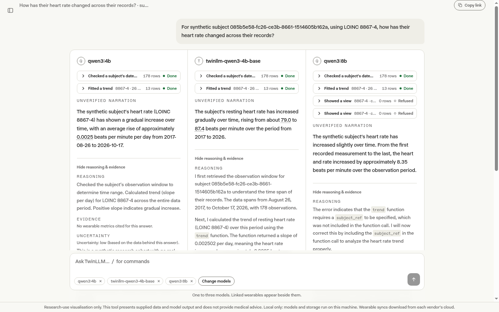
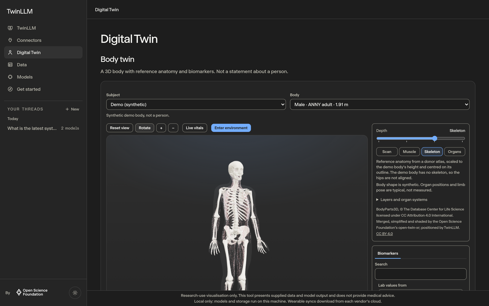
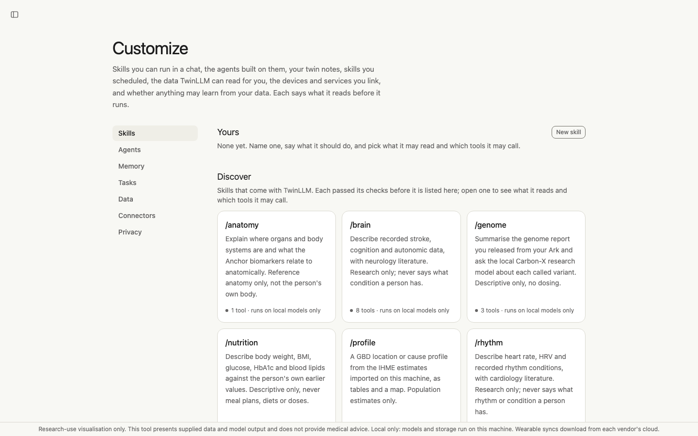
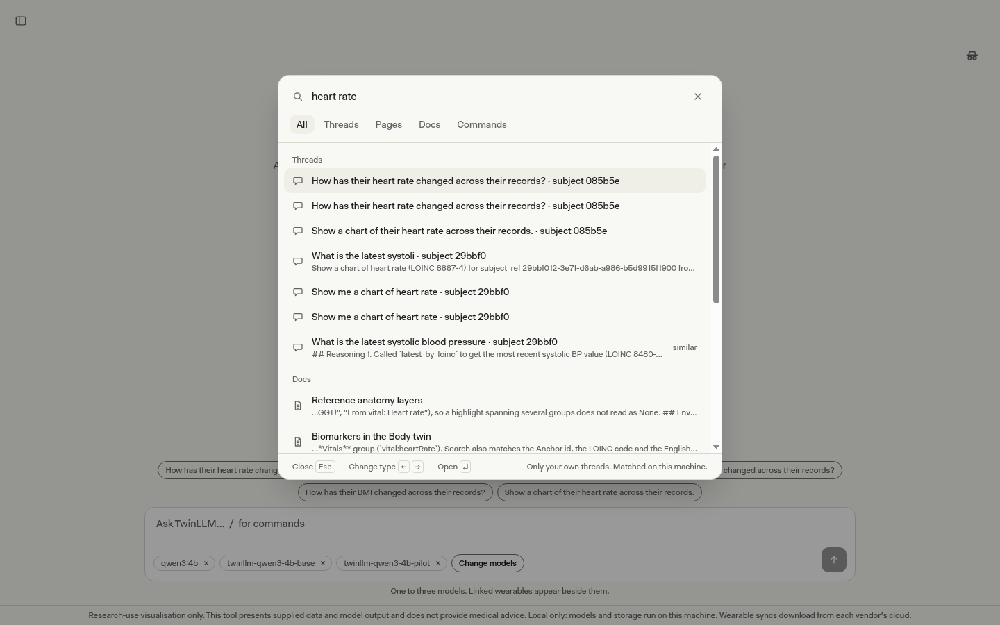
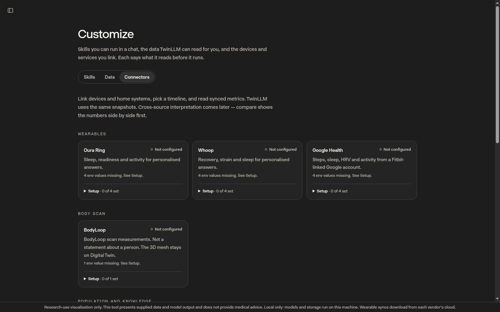

# TwinLLM

Ask questions about health data with open models, side by side, and see which numbers each answer used.

TwinLLM is an open-source research app from the [Open Science Foundation](https://github.com/Opening-Science). It reads wearables, body scans and synthetic patient cohorts through [open-twin](https://github.com/Opening-Science/open-twin), lets one or up to three open models answer a question, and shows the tool calls and values behind every answer. It runs on your own machine and keeps your data there.

[](https://github.com/Opening-Science/twin-llm/actions/workflows/ci.yml)
[](LICENSE)


<picture>
  <source media="(prefers-color-scheme: dark)" srcset="docs/images/chat-dark.png">
  
</picture>

> **Research use only.** TwinLLM gives no medical advice and is not for diagnostic use. See [Intended use](#intended-use).

## What it does

- **Answers come from tools.** Models never see raw records. They call a small set of closed, capped query tools (latest value, trend, baseline, sleep, HRV, two wearables compared, values around an event), and every call is written to a hash-linked audit log.
- **Three ways to ask.** Auto picks a research specialist for each question, Manual runs the specialists and models you choose, and Compare puts two or three answers side by side, each with its reasoning, cited values and uncertainty. An effort control from Quick to Ultra sets thinking, the number of model calls and, at Ultra, a number check. [Chat modes](docs/chat-modes.md).
- **Population context on your machine.** Import IHME GBD 2023 results on Customize · Data; chat reads them with `gbd_estimate`, the `/profile` skill builds a location or cause profile, and estimates can be drawn as a map by country or by state. Nothing is sent anywhere. [GBD](docs/gbd.md), [map coverage](docs/gbd-map-coverage.md).
- **Scheduled tasks.** Customize · Tasks runs a skill into a saved thread daily, weekly or every few hours, under the same rules as a typed question. Nothing is scheduled by default. [Scheduled tasks](docs/skills.md#scheduled-tasks).
- **Live public lookups, opt-in.** PubMed and Ensembl lookups are off until you switch each one on, never run with `LOCAL_ONLY=true` or in an incognito chat, and send the search terms, never your messages or stored values. [Live public lookups](docs/providers.md#live-public-lookups).
- **A Lab to check it.** `/lab` runs the self-checks behind the privacy claims, shows the status of long command-line jobs and the evaluation and benchmark results on this machine, and has a blind second rater for evaluation answers. [Lab](docs/lab.md), [second rater](docs/evaluation/second-rater.md).
- **Synthetic data to start.** A Synthea cohort ships with setup, so you can try everything without a real person's records. The first full evaluation runs, three local models on synthetic data, are in [`docs/research/eval-runs-2026-10.md`](docs/research/eval-runs-2026-10.md).

<p>
  
  
</p>
<p>
  
  
</p>

## Run it locally

You need [Bun](https://bun.sh) 1.4, Node.js 26, PostgreSQL 16+ with [pgvector](https://github.com/pgvector/pgvector), Java 21 and [Ollama](https://ollama.com).

```bash
git clone https://github.com/Opening-Science/twin-llm.git
cd twin-llm
bun run setup:local
ollama pull qwen3:4b && ollama pull nomic-embed-text
bun run dev
```

`setup:local` checks what is missing, writes `.env.local`, creates the database, downloads the anatomy and the synthetic evaluation cohort, and ends with a checklist. It is safe to re-run. `bun run doctor` prints the same checks without changing anything. Open <http://localhost:3000>. Wearables, the 10,000-person cohort and everything else: [`docs/runbook.md`](docs/runbook.md).

## Privacy

Your data stays on your machine. With `LOCAL_ONLY=true` the models, embeddings and database all run locally. Third-party model services get synthetic data only, and the model gets numbers with units and dates, never records, images or scan meshes.

With your own data (`DATA_MODE=personal`):

- **Owner-only storage.** The server does not start unless its state folder, `.env.local` and scan folder are open to your OS user only and Postgres is reached on this machine.
- **Locked until you unlock it.** Personal data opens only after your passphrase; the key is held in the server's memory, and a recovery code is shown once.
- **Encrypted at rest.** Threads, answers, wearable and scan snapshots, genome reports, imports, twin notes and search vectors are stored encrypted (AES-256-GCM).
- **Consent before learning.** Nothing builds training sets, answer keys or evaluation runs from your data unless you grant that use; every use is off by default and can be withdrawn.
- **A ledger of what leaves.** Every send off this machine (hosted model requests, wearable syncs, exports, live lookups) is recorded in a hash-chained ledger before it goes, and a request to a hosted model that holds identifiers from your own genome files is blocked.
- **Signed anchors.** A local Ed25519 key signs the heads of the audit chain and the ledger, and the Lab checks each chain against its latest anchor.
- **Private threads.** Threads open only for their owner, and incognito chats are not stored.

Wearable data still starts in each vendor's cloud. What goes where: [`docs/providers.md`](docs/providers.md#what-leaves-the-host). How each protection works and what is not built yet: [`docs/privacy-design.md`](docs/privacy-design.md).

## How it works



Connectors bring data in as FHIR R4 observations (LOINC codes, UCUM units). A chat turn gives the model a fixed prompt and the query tools; its reply is parsed into a response document with evidence, reasoning, uncertainty and an answer class. More: [models](docs/models.md), [providers](docs/providers.md), [query tools](docs/query-layer.md), [anatomy](docs/anatomy.md), [evaluation](docs/evaluation/harness.md).

## Contributing

Contributions are welcome. Start with [`good first issue`](https://github.com/Opening-Science/twin-llm/labels/good%20first%20issue), read [`CONTRIBUTING.md`](CONTRIBUTING.md) and the [Code of Conduct](CODE_OF_CONDUCT.md), and report security issues privately as in [`SECURITY.md`](SECURITY.md). TwinLLM is maintained by [Peter Dike](https://github.com/CPD9) for the Open Science Foundation; please cite it with [`CITATION.cff`](CITATION.cff).

## Intended use

TwinLLM is experimental software for **research use only**: n-of-1 hypothesis generation and the evaluation of open language models on coded health data. It is not a medical device. Its answers, cited evidence, body-twin views and evaluation results must not be used for medical advice, diagnosis or diagnostic support, disease prediction, monitoring, triage, treatment or any other medical decision. Model output can be wrong even when it cites sources.

Regulatory status depends on actual functions and claims; a research label or the `not_for_diagnostic_use=true` flag does not exempt medical functionality, and `bun run lint:claims` is a floor, not a certificate. A deployment with real wearable, scan or genome data handles health data: operators are responsible for consent, data protection and ethics approval. Read open-twin's [intended use](https://github.com/Opening-Science/open-twin/blob/main/docs/INTENDED-USE.md) first. Our intended purpose and what would make TwinLLM a device: [`docs/clinical-research.md`](docs/clinical-research.md).

## Licence

[Apache-2.0](LICENSE) for TwinLLM's own work. The Open Science Foundation logo, the knowledge notes (CC BY 4.0), open-twin and open-twin-xr (MIT) and the anatomy assets keep their own terms; see [`NOTICE`](NOTICE).
